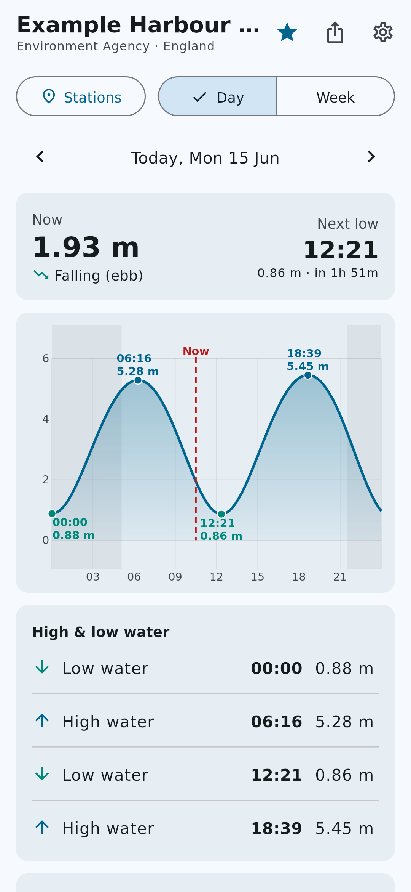
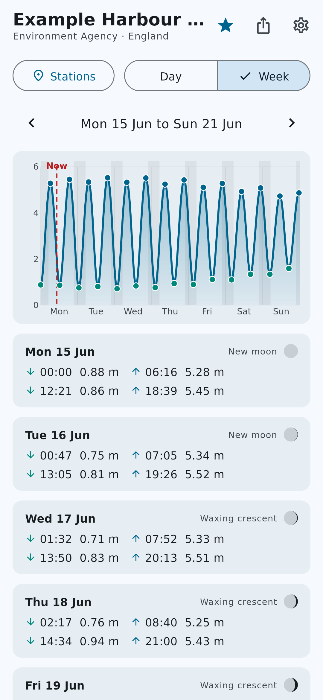
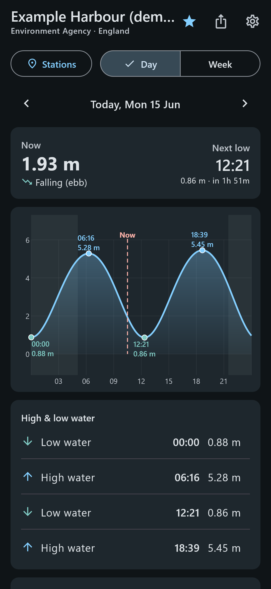
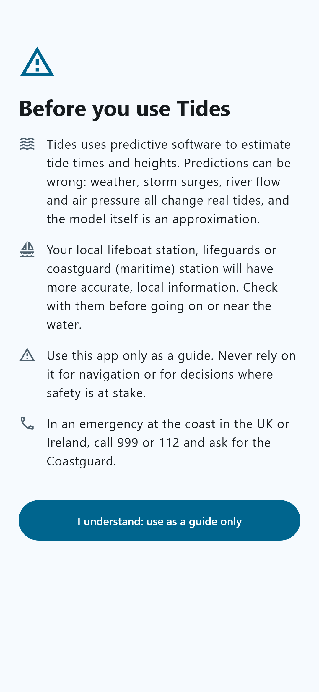
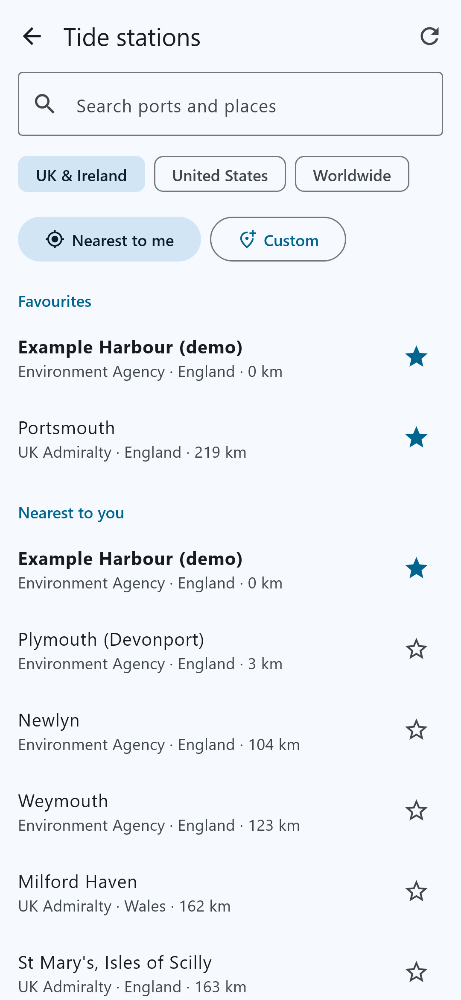
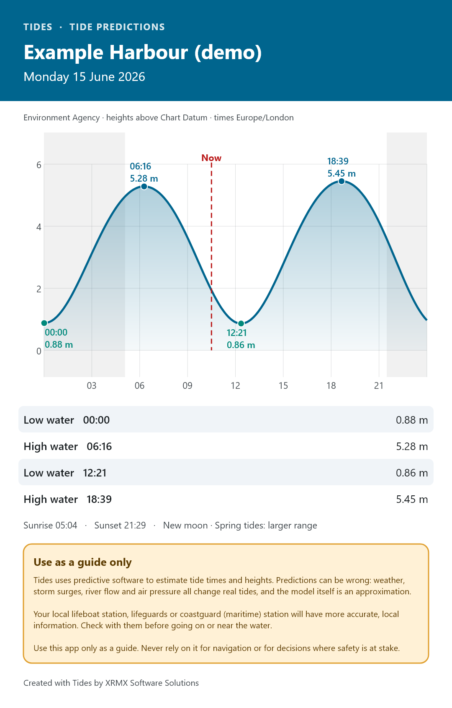
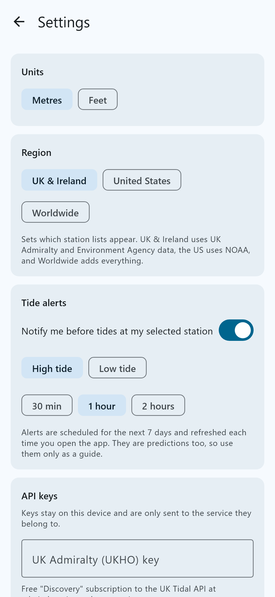

# Tides

**Tide predictions for Android and iOS, built with Kotlin Multiplatform and Compose Multiplatform.**

Developed by **XRMX Software Solutions**.

> [!WARNING]
> **Use as a guide only.** Tides uses predictive software to estimate tide times and heights. Real tides are affected by weather, storm surges, river flow and air pressure, and the model is an approximation. **Your local lifeboat station, lifeguards or coastguard (maritime) station will have more accurate, local information.** Never rely on this app for navigation or for decisions where safety is at stake. In an emergency at the coast in the UK or Ireland, call **999 or 112 and ask for the Coastguard**.

<p align="center">
  
  
  
</p>

---

## Contents

- [Features](#features)
- [User guide](#user-guide)
- [How the predictions work](#how-the-predictions-work)
- [Data sources and API keys](#data-sources-and-api-keys)
- [Building the app](#building-the-app)
- [Project structure](#project-structure)
- [Screenshots](#screenshots)
- [Changelog](CHANGELOG.md)

## Features

- **Day view**: a 24-hour tide curve with high and low water times and heights, the current height, whether the tide is rising or falling, and a countdown to the next tide.
- **Week view**: a 7-day tide curve plus every high and low water for each day. Tap a day to open it.
- **Sunrise, sunset and moon phase**, with night shading on the charts and a spring/neap tide hint.
- **Nearest station by GPS** and searchable station lists.
- **Favourite stations** for quick switching.
- **Tide alerts**: a notification 30 minutes, 1 hour or 2 hours before high and/or low water.
- **Export as PNG and share**: a clean image of the day or week, with the disclaimer included, ready for messages, social media or printing.
- **Works offline** once a station has synced.
- **Metres or feet**, plus light and dark themes.
- Coverage focused on **UK & Ireland**, with **United States** and **worldwide** options.

## User guide

### 1. First launch: the disclaimer



The first time you open Tides it shows a safety disclaimer. Tap **I understand: use as a guide only** to continue. You can read it again at any time from **Settings → Disclaimer**, or by tapping the amber banner at the bottom of the main screen.

<br clear="right" />

### 2. Choose a tide station



Tap **Stations**, then:

- **Nearest to me** uses your location to list the closest stations, with distances.
- **Search** by port or place name.
- Use the **UK & Ireland / United States / Worldwide** chips to change which station lists are shown.
- Tap the **star** to add a station to **Favourites**, which appear at the top of the list.
- **Custom** adds any coastal location worldwide by latitude and longitude. This needs a WorldTides key.

Tap a station to open it. The first time, Tides syncs with the station's data source to calibrate its predictions. After that the station works offline.

<br clear="right" />

### 3. Read the day view


- **Now** shows the current predicted height, whether the tide is **rising (flood)** or **falling (ebb)**, and when the next high or low water is due.
- The **chart** plots the tide over the day. The red dashed line is *now*, shaded areas are night-time, and dots mark high and low water.
- **High & low water** lists each tide with its time and height. Times marked **Official** come straight from the UK Admiralty instead of from Tides' own model.
- **Sun & moon** shows sunrise, sunset and the moon phase. Spring tides (bigger range) follow new and full moons; neap tides (smaller range) follow the quarter moons.
- **About this prediction** explains the source, the height datum, how the model was calibrated and how closely it fits. Tap **Sync now** to refresh it.

Use the **‹ ›** arrows to move between days, and **Today** to jump back.

<br clear="right" />

### 4. Read the week view


Switch to **Week** to see seven days on one chart, followed by each day's highs (▲) and lows (▼). Tap any day to open its day view. The arrows move a week at a time.

<br clear="right" />

### 5. Export and share as PNG



Tap the **share** icon in the top bar:

- **Share image** opens your phone's share sheet (Messages, WhatsApp, email, and so on).
- **Save PNG to device** saves the image to **Pictures/Tides** on Android or to **Photos** on iOS.

The exported image includes the station, the date, the chart, the tide table and the disclaimer.

<br clear="right" />

### 6. Settings



- **Units**: metres or feet.
- **Region**: which station lists to show.
- **Tide alerts**: turn on notifications for high and/or low tide at your selected station, and choose how far in advance. Alerts cover the next 7 days and refresh each time you open the app.
- **API keys**: optional keys for the UK Admiralty and WorldTides (see below).
- **Disclaimer** and **About**.

<br clear="right" />

## How the predictions work

Tides predicts the tide on your phone using **harmonic analysis**, the same method used for official tide tables. The water level is modelled as a sum of tidal constituents, each driven by the motions of the Moon and Sun:

```
h(t) = Z₀ + Σ fᵢ · Hᵢ · cos(Vᵢ(t) + uᵢ − gᵢ)
```

The **astronomical arguments** *V(t)*, the **nodal corrections** *f* and *u* (for the 18.6-year lunar node cycle) and the constituent speeds are all computed in the app. Each station needs its own **harmonic constants** (an amplitude *H* and a phase *g* for each constituent). That is where the reference sources come in:

| Source | Coverage | How Tides gets the constants | Key |
|---|---|---|---|
| **NOAA** | United States | Downloads NOAA's published harmonic constants directly (most accurate) | None |
| **Environment Agency** | England tide gauges | Least-squares fit to the last ~4 weeks of observed 15-minute water levels | None |
| **UK Admiralty (UKHO)** | ~600 UK & Ireland ports | Fit to 7 days of official high and low waters. Official times are shown for those 7 days and the model extends beyond them | Free |
| **WorldTides** | Anywhere | Fit to 7 days of WorldTides heights for your chosen coordinates | Paid |

The fitted constants are stored on the device, so predictions keep working offline. Tides re-syncs with the source when the stored calibration gets old (every 2 days for UKHO, 7 days for EA and WorldTides, 90 days for NOAA), or when you tap **Sync now**. Each station shows the fit's error (RMS) so you can see how closely the model matches its reference data.

When the reference data is too short to separate some constituents (for example a single week of UKHO tide times), the main missing ones (S2, N2, K2, P1) are **inferred** from standard ratios. This is noted under *About this prediction*.

**Heights datum:** UKHO and WorldTides heights are above **Chart Datum**. EA heights are above **Ordnance Datum Newlyn (mAOD)**, which is *not* the same as Chart Datum. NOAA heights are above **MLLW**. The datum is shown on every station.

## Data sources and API keys

Keys are optional. Without any keys you still get Environment Agency gauges in England and every NOAA station in the US.

- **UK Admiralty UK Tidal API**: sign up at the [ADMIRALTY Developer Portal](https://admiraltyapi.portal.azure-api.net/) and subscribe to the free **UK Tidal API – Discovery** product. Paste the key into **Settings → API keys**.
- **WorldTides**: create an account at [worldtides.info](https://www.worldtides.info/) and buy credits. Each sync of a custom location uses a few credits.

Keys are stored only on the device and are only sent to the service they belong to.

Attribution: contains Environment Agency data licensed under the Open Government Licence v3.0. Contains ADMIRALTY data © Crown copyright. NOAA data is in the public domain.

## Building the app

### Requirements

- JDK 17
- Android SDK (API 35), via Android Studio or the command-line tools
- For iOS: a Mac with Xcode 15 or later and [XcodeGen](https://github.com/yonaskolb/XcodeGen)

### Android

```bash
./gradlew :composeApp:assembleDebug
```

The APK is written to `composeApp/build/outputs/apk/debug/`. You can also open the project in Android Studio and run the `composeApp` configuration.

### iOS

```bash
cd iosApp
xcodegen generate
open iosApp.xcodeproj
```

Choose your team under *Signing & Capabilities*, then run on a simulator or device. The Xcode build phase compiles the Kotlin framework through Gradle automatically.

### Tests and screenshots

```bash
./gradlew :composeApp:desktopTest
./gradlew :composeApp:run
```

`desktopTest` runs the tide engine tests: constituent speeds, extreme detection, harmonic fitting and sun/moon calculations. `run` renders the README screenshots into `docs/screenshots/` from the real Compose screens, using a **demo station with made-up constants**, so the screenshots never show real predictions.

### Continuous integration

`.github/workflows/build.yml` runs on every push and pull request. It:

1. runs the unit tests, renders the screenshots and commits them back to `main` when they change;
2. builds the Android debug APK (downloadable from the run's artifacts);
3. builds the iOS app for the simulator on a macOS runner.

## Project structure

```
composeApp/src/
  commonMain/   Shared Kotlin: UI, view model, tide engine, data sources
    engine/     Astronomy, constituents, predictor, least-squares fitter, sun & moon
    data/       UKHO, Environment Agency, NOAA and WorldTides clients, storage, repository
    ui/         Compose screens, chart, theme
    export/     PNG export renderer
  androidMain/  Activity, location, share/save, AlarmManager notifications
  iosMain/      UIViewController entry point, CoreLocation, share sheet, UNUserNotifications
  desktopMain/  Headless screenshot renderer (development only)
  commonTest/   Tide engine tests
iosApp/         SwiftUI host app and XcodeGen project spec
```

## Screenshots

| Disclaimer | Day | Week | Stations |
|---|---|---|---|
|  |  |  |  |

| Settings | Dark mode | Exported PNG |
|---|---|---|
|  |  |  |

*Screenshots use a demo station with made-up data.*

---

© 2026 XRMX Software Solutions. All rights reserved.
